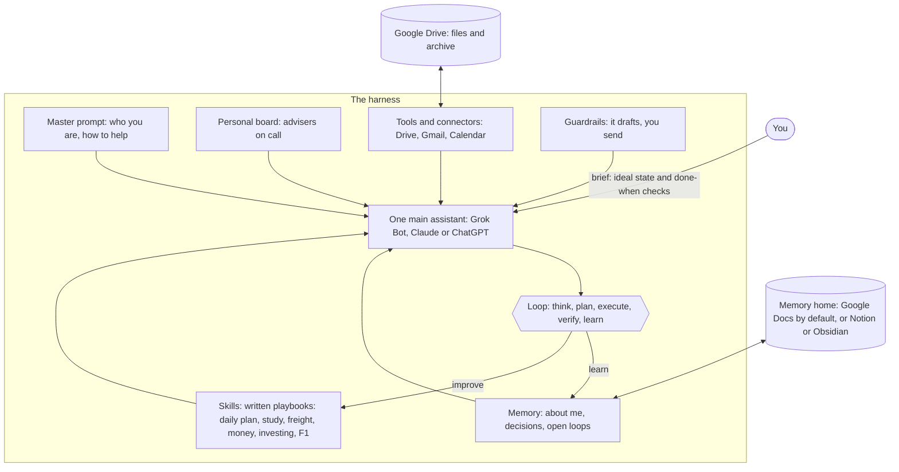

# Personal harness starter kit

A practical setup for running your week with **one AI assistant**, a **written-down memory** and a small **library of playbooks**. It runs on **Grok Bot, Claude or ChatGPT**: you choose. Everything is plain text files, so it moves to whatever comes next without starting again.

No coding. No servers. Three 30-minute evenings to get going, then a few minutes a day.

## The idea in one minute

Your AI has two helpers.

- **The harness** is the frame that holds your hands while you build, so you don't drop the blocks.
- **The memory** is the box where you keep pictures of everything you've already made, so next time you don't start from zero.

The daily habit is just as simple: **pick, show, return.** Each morning pick three things, put them where you'll see them, and at night put back whatever didn't get done.

A bit more precisely: the AI (Grok Bot, Claude or ChatGPT) is the engine. The harness is everything around the engine that makes it useful for *you*, every day, in the same way. It has six parts:

1. **Master prompt.** Who you are, what matters to you and how you want help. Written once, improved often.
2. **Memory.** What the assistant should carry from week to week: your profile, the decisions you've made and your open loops. It lives in your **memory home**: Google Docs in a `Harness` folder in Drive by default, or Notion or Obsidian if you prefer (`memory/MEMORY-LAYERS.md`). You own it.
3. **Skills.** Written playbooks for the jobs you repeat: plan the day, prep a meeting, triage the inbox. Each one says when to use it, the steps, and how you know it's done.
4. **Tools and connectors.** The apps it can reach, such as Google Drive, Gmail and Google Calendar.
5. **Guardrails.** What it must never do. The big one: it drafts, you send.
6. **The loop.** Think, plan, execute, verify, learn. The learn step feeds memory, which is how it gets better.

And one habit sits on top of all six: **write the brief first.** Before the assistant starts, say what "good" looks like and how you'll check it's done. Most bad AI output is a vague brief, not a weak model.

## The layers



If the diagram doesn't show (it needs GitHub or a Mermaid-aware viewer), open `images/harness-layers.png` (the core layers; the board is a skill, so it sits in the Skills layer), or read it top to bottom: you give a brief; the master prompt, memory, skills, your personal board, tools and guardrails all feed one assistant; the assistant works through the loop; and what it learns goes back into memory and the skills.

## Choose your path

| | **1. Grok Bot (recommended)** | **2. Claude** | **3. ChatGPT** |
|---|---|---|---|
| Writes your memory home without you | Yes: its own always-on computer runs routines that update your Docs | Mostly: cloud scheduled tasks with connectors and an approval mode (not tested hands-free) | No: in a chat you're in, usually after you confirm |
| Scheduling | Routines, up to 50 per Bot | Scheduled tasks, all paid plans | 5 scheduled tasks on Plus; can't read project files |
| Connectors | Marketplace, plus any website through its browser | Drive, Gmail, Calendar, Google Docs (beta), Notion, custom MCP | Drive, Gmail, Calendar, Notion |
| Cost | Included with a paid Cursor plan or a linked SuperGrok plan | Pro US$20 a month | Plus about US$20 a month |
| Set-up effort | Low | Medium | Medium |
| Guide | `GROK-BOT.md` | `CLAUDE.md` | `CHATGPT.md` |

The full comparison, the shared core and the red lines are in `SETUP.md`. Adrian, you choose; the order is mine, and it's about how much runs without you having to remember.

## Where each layer lives in ChatGPT (checked October 2026)

For the same table on the other paths, see `GROK-BOT.md` and `CLAUDE.md`.


| Layer | In ChatGPT | Where it really lives |
|---|---|---|
| Master prompt | **Custom Instructions** (Settings > Personalization) for the short version, plus **Project instructions** and the full master prompt as a file in the **Project's Sources** | `Master Prompt` Doc in your memory home |
| Memory | **Memory** (saved memories and chat history) and **Project memory** | Telos, About me, Open loops, Decisions log Docs in your memory home (`memory/MEMORY-LAYERS.md`) |
| Skills | Skill files uploaded to the **Project's Sources** (works on any plan). ChatGPT's own **Skills** feature is optional, see `CHATGPT-FEATURES.md` | `skills/` in this kit (a copy in your memory home) |
| Tools and connectors | **Apps** (Settings > Apps; the directory is now called Plugins): Google Drive, Gmail, Google Calendar | Your Google account |
| Guardrails | Written into the master prompt, plus ChatGPT's own confirmations before actions, plus your security settings | `MASTER-PROMPT.md` and `CHATGPT.md` Step 1 |
| Loop | Written into the master prompt and every skill. **Work** mode for longer jobs, **Scheduled** tasks for routines | Every skill's "Done when" checks |

The honest limits are in `CHATGPT-FEATURES.md`. The biggest one: ChatGPT can only write memory to tools it can reach, and only in a chat you're in. Google Docs work on every path, which is why they're the default memory home.

## What it does for you (three jobs)

| Job | What that means | Where it lives |
|---|---|---|
| **A digital assistant** | Morning brief from your calendar and inbox, a daily plan, an evening check-in, reminders, capture by voice from your phone | daily-plan, capture, inbox-triage, meeting-prep; routines or scheduled tasks (your path guide, Week 2) |
| **A second brain** | Capture, organise, distil, express (Tiago Forte's CODE) into PARA folders in Drive (or Obsidian), with a weekly review that actually updates memory | capture, weekly-review, `vault-template/`, `memory/README.md` |
| **A LifeOS** | A Telos (mission, goals with "done when" checks, 90-day priorities, habits), every area of life covered, a decision log, a personal board, and daily, weekly, monthly and quarterly reviews | `memory/telos.md`, periodic-review, personal-board, money and investment managers |

## How to talk to it

Talk to it like a sharp, friendly chief of staff. Short is fine. A few phrases do most of the work:

- "Plan my day." / "Evening check."
- "Capture: call Thabo about the Durban backlog next week." (voice works well)
- "Remind me Friday at 8 am to book the car service." (sets a scheduled task)
- "Process my inbox." / "Triage my email."
- "Prep me for my 2 pm." / "Research: [question]."
- "Quiz me on this week's strategy reading." / "Freight: how would you explain DDP to a new client?"
- "Money check-in." / "Investment review."
- "Ask the CFO: ..." / "Convene the board: ..."
- "Weekly review." / "Monthly review." / "Quarterly review."

If it ever does something you didn't want, just say so. Correct it once in the chat and fix the file; that's how it learns.

## Built for you, Adrian

On top of eight core skills (daily plan, capture, weekly review, monthly and quarterly review, inbox triage, meeting prep, research brief, skill writer), the kit has six built around you:

- **MBA study partner.** A Socratic tutor and case-method sparring partner: flashcards with spaced recall, exam prep, reading notes into your memory home, and essay feedback that never writes your work for you.
- **Freight-forwarding partner.** Talks Incoterms 2020, customs, FCL and LCL, air versus sea, demurrage and detention, rate indices, and South African ports, SARS Customs and trade rules, with a weekly news watch. No source, no number.
- **Money manager** and **Investment manager**, kept separate on purpose: one runs the budget, bills, goals and net worth in a Google Sheet; the other reviews your portfolio against your own written policy and makes you write the thesis before you buy. General information only, not financial advice.
- **F1 daily brief.** A scheduled morning brief with session times in your time zone, results, standings and headlines.
- **Personal board of directors.** Ten standing advisers (Chair, CFO, Investor, Mentor, Professor, Forwarder, Coach, Partner, Contrarian, Conscience) plus a guest seat. Call one member or the whole board; every board decision lands in your decisions log. See `board/README.md`.

## Quick start (about 30 minutes)

1. Read `SETUP.md` and pick your path.
2. Open that path's guide (`GROK-BOT.md`, `CLAUDE.md` or `CHATGPT.md`) and do **Evening 1 only**: lock the doors, set up the assistant with the eight core skills, run your first daily plan.
3. Then Evening 2 (master prompt), Evening 3 (memory home in Google Drive), then Weeks 1 to 3.

## What's in this folder

```text
personal-harness-starter/
  README.md              this page
  SETUP.md               start here: choose your path, shared core, red lines
  GROK-BOT.md            path 1 (recommended): Grok Bot, step by step
  CLAUDE.md              path 2: Claude, step by step
  CHATGPT.md             path 3: ChatGPT, step by step
  MASTER-PROMPT.md       the master prompt template and interview
  CHATGPT-FEATURES.md    what ChatGPT can and can't do, checked October 2026
  SOURCES.md             every link, checked
  LICENSE                MIT
  images/                the layers diagram as a picture
  skills/                fourteen playbooks, one folder each
    daily-plan/SKILL.md           core: plan the day, evening check
    capture/SKILL.md              core: voice and phone capture, inbox, progressive summarisation
    periodic-review/SKILL.md      core: monthly and quarterly reviews
    weekly-review/SKILL.md        core: review the week, update memory
    meeting-prep/SKILL.md         core
    inbox-triage/SKILL.md         core
    research-brief/SKILL.md       core
    skill-writer/SKILL.md         core: writes new skills
    mba-study-partner/SKILL.md    tutor, case discussion, flashcards, exam prep
    freight-partner/SKILL.md      freight forwarding and logistics, news watch
    money-manager/SKILL.md        budget, bills, goals, net worth
    investment-manager/SKILL.md   portfolio, research memos, thesis journal
    f1-daily-brief/SKILL.md       daily Formula One brief on a schedule
    personal-board/SKILL.md       convene your board of directors
  board/                 your personal board: why these seats, persona cards
  drive-templates/       money-tracker.csv to import into Google Sheets
  memory/                templates for your memory layer
    README.md           the memory loop: what gets written where, and when
    MEMORY-LAYERS.md    where your memory lives, with notes for each path
    telos.md            mission, goals with done-when checks, 90-day priorities, habits
    about-me.md
    decisions-log.md
    open-loops.md
  vault-template/        optional Obsidian vault skeleton and note templates
```

## The rules of thumb

- **One assistant, many skills.** Don't build an assistant for every job. Write a skill instead. Most ideas for a "new agent" are really a missing playbook.
- **Harness first, then skills, then agents.** Get the frame and the playbooks right and one assistant does most of the work.
- **Less surface, more use.** Three tools you use beat ten you maintain.
- **Brief before work.** Ideal state and "done when" checks first, every time.
- **It drafts, you send.** Nothing goes out, gets paid or gets deleted without you.
- **You own the memory.** Your memory home (Google Docs by default) is the source of truth, and nothing is written there that you haven't approved, either each time or once when you set up a routine. The assistant's own memory is a convenience, not the record.

## Where the ideas come from

- Ruby Wolff, *I Built My Own Agent Graveyard* (Gem Alpha GA-13): one meta agent in a harness, calling a library of skills.
- Daniel Miessler's Personal AI Infrastructure (now LifeOS): the think, plan, execute, verify, learn loop, and his point that the real bottleneck is describing the ideal state.
- Tiago Forte, *Building a Second Brain*: PARA (Projects, Areas, Resources, Archive) and CODE (Capture, Organise, Distil, Express).
- Nick Milo, Linking Your Thinking: Obsidian, home notes and maps of content.
- Tiago Forte and Hayden Miyamoto, the Master Prompt Method: give the AI the full context a new employee would need.

Links for all of these are in `SOURCES.md`.

## Licence

MIT. Use it, change it, share it. See `LICENSE`.
